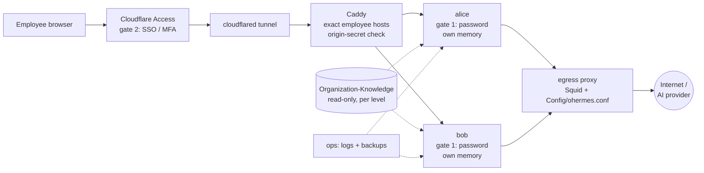

# Hermes Open Enterprise

**A multi-user, self-hosted template for running [Hermes Agent](https://hermes-agent.nousresearch.com)
(by Nous Research) for a whole organization with plain Docker Compose.**

Every employee gets their **own isolated agent** in the browser — own container, own network, own
subdomain, own memory — while the organization shares **read-only company knowledge** (policies, product,
brand, KPIs, core values, skills) at three levels: organization, department and person. Settings are locked
by the admins, outbound web access goes through a rule-based egress proxy, and an organization guard plugin
screens tool calls for leaks and prompt-injection.

> Hermes Open Enterprise is an independent community project. It is **not affiliated with, endorsed by or
> supported by Nous Research**. Hermes Agent is a separate project under its own license.

Repository: `https://github.com/Kissofbeauty/hermes-open-enterprise`

## Contents

- [Features](#features)
- [Architecture](#architecture)
- [Requirements](#requirements)
- [Quick start (dev)](#quick-start-dev)
- [Production install](#production-install)
- [Managing employees — `ohermes`](#managing-employees--ohermes)
- [Organization-Knowledge](#organization-knowledge)
- [Website rules](#website-rules)
- [Locked settings and org-guard](#locked-settings-and-org-guard)
- [Logs and backups](#logs-and-backups)
- [Automatic deploy and GitHub settings](#automatic-deploy-and-github-settings)
- [Upgrading](#upgrading)
- [Troubleshooting](#troubleshooting)
- [Security model and known limitations](#security-model-and-known-limitations)
- [Project structure](#project-structure)
- [Guides](#guides) · [Using this template](#using-this-template) · [Contributing](#contributing) · [License](#license)

---

## Features

- **Per-employee isolation** — one container + one `internal` Docker network (/28) + one subdomain per
  employee (`https://<subdomain>.<your-domain>`). Employees are identified by email; their server name never
  changes and is never reused.
- **Organization-Knowledge, 3-level assignment** — `Organization/Assign` (everyone) → `Department/<Dept>/Assign`
  (that department) → `Department/<Dept>/<name>` (that employee). Each folder is mounted read-only on its own,
  so an agent sees only its organization, its own department and its own folder.
- **`ohermes` CLI** — joiners, movers and leavers in one command. Leavers are **archived, never deleted**;
  `restore` brings an agent back with its memory.
- **Egress web rules (`Config/ohermes.conf`)** — allow/deny websites per organization, department and person,
  enforced by a Squid proxy that is the agents' only route to the internet. Applied without restarting agents.
- **org-guard plugin** — blocks tool calls that carry secrets, key formats, canary markers, personal data or
  verbatim Organization-Knowledge to outbound tools; asks the employee before uploads, form submits and
  writes to memory/skills; strips invisible Unicode and marks outside content as untrusted.
- **Locked configuration** — Hermes' settings, key file, persona, hooks, plugins and shell start files are
  generated at every start and mounted read-only. Neither the agent nor the dashboard can change tools,
  plugins, approvals or the AI provider/model/base URL.
- **AI model** — one central provider/model/key, or a personal one per employee.
- **Two login gates** — Cloudflare Access (SSO/MFA) in front, plus a per-employee Hermes password.
  Caddy serves only the exact employee hosts it knows and, in production, only requests carrying a
  Cloudflare-added origin secret.
- **Hardened containers** — images pinned by version and digest, `cap_drop: ALL`, read-only root filesystem,
  process and tmpfs limits.
- **Backups and log rotation** — daily logs (30-day retention, archive) and nightly backups (optional
  [age](https://age-encryption.org) encryption).
- **GitOps auto-deploy (optional)** — merge to `main` → GitHub Actions → SSH forced command on the server.

## Architecture



```
Browser ─► Cloudflare Access ─► Tunnel ─► Caddy ─┬─► alice  (own network, memory; locked settings)
                                                 └─► bob    (own network, memory; locked settings)
                          read-only mounts ─► Organization-Knowledge: organization · own department · own folder
Agents ─► egress (Squid, rules from Config/ohermes.conf) ─► internet     (employee networks have no direct route)
```

## Requirements

- **Linux** server for production (development also works on Docker Desktop for Windows/macOS)
- **Docker Engine 28+** and **Docker Compose v2.33.1+** (`include:` and network `gw_priority`)
- `bash`, `git`, `openssl` on the host
- An AI provider key (OpenRouter, Anthropic, OpenAI, Gemini, … or any OpenAI-compatible endpoint)
- Production: a domain on Cloudflare with Zero Trust (Tunnel + Access)

## Quick start (dev)

```bash
git clone https://github.com/Kissofbeauty/hermes-open-enterprise.git
cd hermes-open-enterprise
cp .env.example .env               # set AI_PROVIDER, AI_MODEL and AI_API_KEY
docker compose up -d
./ohermes create -e alice.s@example.com -s alice -d Sales -t "Account Manager"   # asks for a password
# open http://alice.localhost:8080
```

`create` also applies the website rules (a fresh install denies all websites until `./ohermes reconf` or the
first `create`). `STAGE=dev` disables the Cloudflare checks — **never use it on a server reachable from the
internet.**

## Production install

1. Install Docker Engine + Compose. Clone your organization's **private** copy as **root** (the checkout must
   belong to root when auto-deploy is used).
2. `cp .env.example .env`, `chmod 600 .env`, and set at least:

   | Key | Value |
   |---|---|
   | `STAGE` | `prod` |
   | `COMPOSE_PROFILES` | `tunnel` (starts cloudflared) |
   | `HERMES_DOMAIN` · `PUBLIC_SCHEME` · `PUBLIC_PORT_SUFFIX` | `hermes.example.com` · `https` · (empty) |
   | `CLOUDFLARE_TUNNEL_TOKEN` | token of your tunnel |
   | `ORIGIN_SECRET` | `openssl rand -hex 32` (≥ 32 characters) |
   | `AI_PROVIDER` · `AI_MODEL` · `AI_API_KEY` (· `AI_BASE_URL`) | central AI model; set a spending limit on the key |
   | `BACKUP_AGE_RECIPIENT` | an age public key (keep the private key off the server) |

   All keys are described in [guides/admin.md](guides/admin.md#env-keys).
3. **Cloudflare**:
   - Tunnel public hostname `*.<domain>` → `http://caddy:80`.
   - Transform Rule (Modify Request Header) for `*.<domain>`: set `X-Hermes-Origin` = `ORIGIN_SECRET`.
     Without it every request gets 403 — by design.
   - Access: a **catch-all application for `*.<domain>`** (deny by default / only your IdP group) **plus** one
     application per employee subdomain allowing that employee's email. Caddy checks that an Access token is
     present but cannot verify it, so every hostname must sit behind Access. Optionally enable
     "Protect with Access" on the tunnel hostname so cloudflared validates the token.
4. `sudo docker compose up -d` → `sudo ./ohermes reconf` → `sudo ./ohermes create …` per employee.
5. `sudo chmod 700 Backups Archive`; optionally apply the host firewall
   (`sudo Infrastructure/host/firewall.sh apply`, see [guides/admin.md](guides/admin.md#11-host-hardening)).

## Managing employees — `ohermes`

```
ohermes create   -e <email> -s <subdomain> [-p <password>] [-d <department>] [-t <title>]
ohermes update   -u <user> [-d <department>] [-t <title>] [-e <email>] [-s <subdomain>]
ohermes rm       -u <user>          # stop + move to Archive/ (asks Y/n, nothing deleted)
ohermes restore  -u <user>
ohermes repasswd -u <user>          # new dashboard password, signs out all sessions
ohermes ls                          # employees, status, model (central/personal), links
ohermes model    -u <user> [--show|--reset]   # personal AI model + key (admins, on the server)
ohermes check                       # validate Config/ohermes.conf
ohermes reconf   [--dry-run]        # apply Config/ohermes.conf to the egress proxy
ohermes sync                        # rebuild generated files (employee list, Caddy routes, runtime files)
```

`<user>` is the server name or the email. Server name = email local part, lowercase, other characters → `-`
(`Alice.S@example.com` → `alice-s`); it never changes. On Linux run with `sudo`. After `create`/`update -s`/
`restore`, add or change the employee's Cloudflare Access application; before `rm`, remove it and revoke
personal API keys. Details: [guides/admin.md](guides/admin.md#3-ohermes-command-reference).

## Organization-Knowledge

```
Organization-Knowledge/Organization/
  Assign/                    Skills · Policy · Knowledge · KPI · Core-values   → everyone (/opt/org/organization)
  Department/<Dept>/Assign/  Skills · KPI · Knowledge                          → that department (/opt/org/department)
  Department/<Dept>/<name>/  Skills · KPI · Knowledge                          → that employee (/opt/org/me)
  Department/General/        employees without a department
```

`ohermes` creates, moves and archives the department and personal folders; if `Organization-Knowledge/` is its
own git repository, set `[organization-knowledge] manage_folders = off` in `Config/ohermes.conf` and it never
touches the folder (it only lists what is missing). Markdown files take effect immediately. Skill name clashes:
Organization > Department > Employee. **Skills are
instructions every agent follows** — treat them like code: changes to any `Skills/` folder need sysadmin review
(CODEOWNERS) and CI flags them. More: [guides/admin.md](guides/admin.md#4-organization-knowledge).

## Website rules

`Config/ohermes.conf` (admins only, never visible to agents), applied with `sudo ./ohermes reconf`:

```
[web]
default   deny                      # or: allow
[web:organization]
allow     registry.npmjs.org        browser driver (needed under default deny)
allow     models.dev                model catalog, fetched at every start (needed under default deny)
allow     *.wikipedia.org           Reference
[web:department=Sales]
allow     *.salesforce.com          Sales CRM
[web:user=alice-s]
allow     canva.com                 Slides
```

Sites are `example.com`, `*.example.com` or a single IP. Decision order: safety denies (ports, private
addresses, connection cap) → AI provider always allowed → any deny (**deny always wins**) → any allow →
raw-IP destinations denied → default. HTTPS is not decrypted (host name only). The template ships
`default allow` so a fresh install works; switch to `default deny` for production.
More: [guides/admin.md](guides/admin.md#5-website-rules--configohermesconf).

## Locked settings and org-guard

- At every start `Infrastructure/hermes/setup.py` (root) merges `Config/defaults.yaml` → `Users/<name>/config.yaml`
  → AI model → `Config/enforced.yaml` → generated values into a read-only `config.yaml`, and writes the key file,
  persona (`Config/SOUL.md`), empty hooks/profiles and empty shell start files — all mounted read-only. Dashboard
  settings pages and `hermes config set` fail by design. Every AI provider except the admin-set one is disabled.
- **org-guard** checks every tool call (secrets, key formats, canary markers, personal data, Organization-
  Knowledge copies to outbound tools, writes to memory/skills/instruction and shell start files, nested Hermes,
  secret files) and cleans tool output. Blocks are logged as signed `ORG-GUARD …` lines in
  `docker compose logs <name>`; check them with `Infrastructure/hermes/verify_guard_log.py`.

Details: [guides/admin.md](guides/admin.md#6-locked-hermes-settings) and
[guides/admin.md](guides/admin.md#8-org-guard).

## Logs and backups

The `ops` container (no network) collects Docker logs at 00:15 and backs up `Users/` and
`Organization-Knowledge/` at 02:00 (`Backups/daily`, `weekly`, `archive`; age-encrypted with
`BACKUP_AGE_RECIPIENT`). Run now: `docker compose exec ops /ops/backup.sh` / `/ops/logs.sh`. Copy `Backups/` off
the server. Egress log: `Logs/egress/access.log` (root-only). More:
[guides/admin.md](guides/admin.md#10-logs-and-backups).

## Automatic deploy and GitHub settings

Optional: merge to `main` → GitHub Actions → SSH with a forced-command key → `sudo` runs one root-owned copy of
`Infrastructure/deploy/deploy.sh` → fast-forward, `ohermes sync`, `docker compose up -d`, rolling restart when
needed, `ohermes reconf`. Needs a deploy user (not in the docker group), the sudoers line, the
`production` environment with required reviewers and secrets (`DEPLOY_HOST`, `DEPLOY_PORT`, `DEPLOY_USER`,
`DEPLOY_SSH_KEY`, `DEPLOY_KNOWN_HOSTS`) and the variable `DEPLOY_ENABLED=true`. **Anyone who can merge into `main`
effectively has root on the server** — protect it.

After the first push, enable private vulnerability reporting, secret scanning + push protection, Dependabot,
a ruleset for `main` (PR + Code Owners review + status checks `lint` and `secret-scan` + signed commits + no force
push) and read-only Actions permissions. Step by step: [guides/deploy.md](guides/deploy.md) (the checklist is in
[section 3](guides/deploy.md#3-github-repository-settings-after-the-first-push)).

## Upgrading

`git pull` (or the automatic deploy) → `sudo ./ohermes sync` → `sudo docker compose up -d` →
`sudo ./ohermes reconf`. `sync` regenerates outdated `Users/<name>/compose.yml` files from the template (old file
kept as `compose.yml.old`) and rebuilds the Caddy routes. Release-specific steps are in [CHANGELOG.md](CHANGELOG.md)
and [guides/admin.md](guides/admin.md#12-upgrades).

## Troubleshooting

| Symptom | Fix |
|---|---|
| Every request 403 in production | `ORIGIN_SECRET` missing/short, or the Transform Rule does not set `X-Hermes-Origin` |
| 404 for an employee's link | `sudo ./ohermes sync` (rebuilds `Infrastructure/caddy/generated/routes.caddy`) |
| An employee's container does not start (missing file) | `sudo ./ohermes sync` |
| All websites refused after install | `sudo ./ohermes reconf` |
| Browser tools missing (`could not install the browser driver`) | allow `registry.npmjs.org`, `ohermes reconf`, restart the employee |
| Dashboard settings cannot be saved | by design — settings are locked |

Never set `COMPOSE_FILE` in `.env`, never reuse `EMP_NET_ID`, never edit generated files (`runtime/`,
`docker-compose.override.yml`, `Infrastructure/*/generated/`). More:
[guides/admin.md](guides/admin.md#13-troubleshooting-and-gotchas).

## Security model and known limitations

Two login gates, exact-host routing, per-employee network isolation, read-only knowledge and settings, a single
egress path with web rules, and a pattern-based guard on tool calls. Full model: [SECURITY.md](SECURITY.md).

**Known limitations — read before deploying:**

- **`default allow` is weak** — the template ships `default allow` (accepted for a pilot); with it only listed
  websites are blocked. Switch to `default deny`. Either way, any allowed website can still receive data an agent
  is tricked into sending.
- **Cloudflare Access must cover every hostname** — Caddy checks that an Access token is present, not that it
  is valid; use a catch-all `*.<domain>` Access application.
- **org-guard is a pattern filter, not a sandbox** — split, re-encoded or re-worded leaks can pass, and
  obfuscated shell commands can bypass its text-based checks.
- **Shared AI key** — with the central key, every agent can read it (Hermes runs dashboard, gateway and tools as
  the same user). Set a spending limit; give heavy users a personal key. The AI provider host is always allowed.
- **Prompt injection** from documents, websites or memory is reduced, not eliminated.
- **Admins see everything** — root on the server can read every conversation; anyone who can merge to `main`
  effectively has root when auto-deploy is on.
- **Container isolation relies on the host kernel and Docker Engine** — keep them patched; consider the host
  firewall helper.
- Backups contain `.env` files and AI keys; they are unencrypted unless `BACKUP_AGE_RECIPIENT` is set.
- Not yet verified end-to-end behind a real Cloudflare tunnel or with a real AI provider; Linux host file
  permissions and interactive `ohermes model` are only partly tested.

## Project structure

```
.env.example                 system settings (copy to .env — never committed)
docker-compose.yml           shared services: caddy, egress, ops, cloudflared (never edited by ohermes)
docker-compose.override.yml  generated by ohermes, git-ignored: employees + their networks
ohermes                      employee management CLI (bash)
Users/_template/             copied for every new employee
Users/<name>/                .env (login) · compose.yml · config.yaml · data/ · model/ · runtime/ (git-ignored)
Organization-Knowledge/      read-only company knowledge (see above)
Config/                      defaults.yaml · enforced.yaml · SOUL.md (locked Hermes settings) ·
                             ohermes.conf (website rules — admins only, never mounted into an agent)
Infrastructure/              caddy/ (+ generated/ routes) · egress/ · hermes/ (setup.py, org-guard, skills, tests,
                             verify_guard_log.py) · ops/ · deploy/ · host/ (optional firewall helper)
guides/                      admin and deploy guides
Archive/ Logs/ Backups/      runtime data (git-ignored)
```

## Guides

| Document | Content |
|---|---|
| [guides/admin.md](guides/admin.md) | Install, `.env`, Cloudflare, `ohermes`, Organization-Knowledge, web rules, locked settings, AI model, org-guard, browser, logs/backups, host hardening, upgrades, troubleshooting |
| [guides/deploy.md](guides/deploy.md) | GitOps auto-deploy, GitHub repository settings checklist, rollback |
| [SECURITY.md](SECURITY.md) | Security model, known limitations, how to report a vulnerability |
| [CONTRIBUTING.md](CONTRIBUTING.md) | Branch model, commits, tests, PR checklist |
| [CHANGELOG.md](CHANGELOG.md) | Release notes |

## Using this template

This public repository contains **no organization data**. Create a **private** copy for your organization.
Employee folders, personal and department knowledge folders (except `General`), `.env` files, data, logs and
backups are git-ignored by default — remove those rules in your private copy if you want to track them.

## Contributing

See [CONTRIBUTING.md](CONTRIBUTING.md) and the [Code of Conduct](CODE_OF_CONDUCT.md). Please report security
issues privately as described in [SECURITY.md](SECURITY.md).

## License

[MIT](LICENSE) © 2026 Hermes Open Enterprise contributors. Hermes Agent is a separate project by Nous Research
under its own license; this project is not affiliated with Nous Research.
